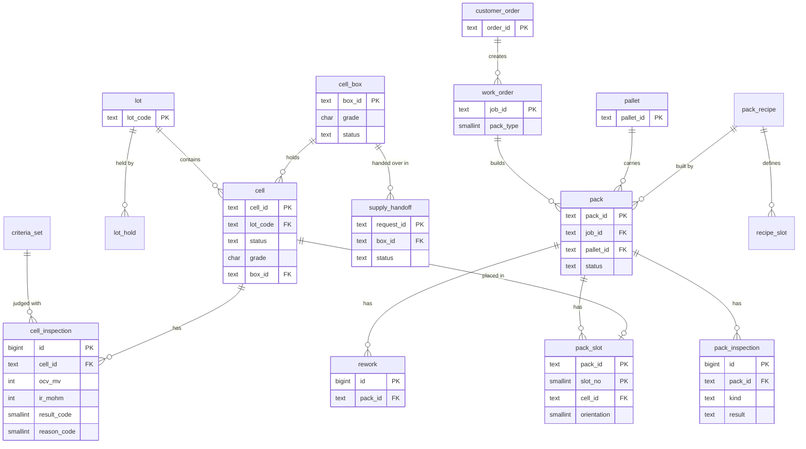

# DB 설계 초안 (11/20)

PostgreSQL 기준. 팀이 합의하기 전 초안이라 이름과 형식은 바뀔 수 있다.
근거: digital-twin-a `docs/interface.md`(측정값 블록·결과 코드), `docs/design-notes.md`(판정·LOT 보류·인계 규칙),
pack-production `docs/process.md`(팩 공정).

## 전체 흐름

```
LOT ─< 셀 ─< 셀 검사                           (2A)
        │
        └─> 셀 박스(등급별 4셀) ─< 공급 인계     (2A → 팩 라인)
                    │
주문 ─< 작업 ─< 팩 ─< 팩 슬롯(셀 1개씩)          (팩 라인)
                 ├─< 팩 검사 (조립 비전 · 전압)
                 └─< 재작업
모든 기록 ──> 이벤트 로그 (중복 제거용 event_id)
```

## ERD



## 1. 공통

### event_log: 모든 쓰기의 원본 기록

design-notes의 "DB 반영(이벤트 ID로 중복 제거)" 규칙을 위한 테이블이다. 수집기가 같은 이벤트를 다시 보내도 한 번만 반영된다.

| 컬럼 | 형식 | 설명 |
|---|---|---|
| event_id | uuid PK | 수집기가 만든 ID. 재시도 때 같은 값 |
| source | text | `2A` / `PACK` / `2B` |
| station_code | text FK | 예: `2A-Z2`, `PACK-R1`, `PACK-VIS2` |
| event_type | text | 예: `cell.inspected`, `pack.slot_filled` |
| entity_id | text | 대상 셀·팩·박스 ID |
| payload | jsonb | 원본 값 (PLC 블록 그대로) |
| occurred_at | timestamptz | 현장 시각 |
| received_at | timestamptz | DB 저장 시각 (기본값 now()) |

### station: 스테이션 목록

| 컬럼 | 형식 | 설명 |
|---|---|---|
| station_code | text PK | `2A-VIS1`, `2A-Z2`, `PACK-VIS1`, `PACK-R1`, `PACK-VIS2`, `PACK-R2`, `PACK-VT`, `PACK-R3` |
| line | text | `2A` / `PACK` / `2B` |
| name | text | 화면 표시 이름 |

## 2. 셀 (2A가 씀)

### lot

| 컬럼 | 형식 | 설명 |
|---|---|---|
| lot_code | text PK | interface.md D2102 (지금은 1 / 4 / 7 같은 숫자) |
| received_at | timestamptz | 입고 시각 |
| is_held | boolean | 지금 보류 중인지 (lot_hold 최신 행과 일치) |

### lot_hold: 보류 이력 (지우지 않음)

| 컬럼 | 형식 | 설명 |
|---|---|---|
| id | bigserial PK | |
| lot_code | text FK | |
| held_at | timestamptz | |
| ng_count | int | 보류 시점의 확정 NG 누계 (기준 3건) |
| released_at | timestamptz | null이면 보류 중 |
| released_by | text | 검토자 |
| note | text | 원인과 조치 |

### criteria_set: 판정 기준값 버전

SCADA에서 바꾸는 D2200~ 값이다. 바뀔 때마다 새 행을 추가해서 어떤 기준으로 판정했는지 남긴다.

| 컬럼 | 형식 | 설명 |
|---|---|---|
| id | serial PK | |
| ocv_min_mv / ocv_max_mv | int | D2200 / D2201 (3500 / 3800) |
| ir_max_mohm | int | D2202 (60) |
| grade_a_min_mv / grade_b_min_mv | int | D2203 / D2204 (3750 / 3650) |
| lot_ng_limit | int | D2205 (3) |
| valid_from | timestamptz | |

### cell

| 컬럼 | 형식 | 설명 |
|---|---|---|
| cell_id | text PK | 1차 비전에서 부여 (지금은 D2100 32비트 일련번호를 문자열로) |
| lot_code | text FK | |
| status | text | 아래 상태 코드 |
| grade | char(1) | `A` / `B` / `C`. 합격 전에는 null |
| box_id | text FK | 담긴 셀 박스 |
| box_slot | smallint | 박스 안 위치 1~4 |
| created_at | timestamptz | 1차 비전 시각 |

셀 상태 (`cell.status`):

| 값 | 뜻 | 바뀌는 때 |
|---|---|---|
| `registered` | ID 부여, 검사 전 | 1차 비전 |
| `waiting` | 재측정·식별 대기 (NG 아님) | 측정 실패, QR 미판독 |
| `passed` | 합격, 등급 있음 | 검사 결과 1/2/3 |
| `rejected` | 부적합 확정 | 결과 9 |
| `boxed` | 셀 박스에 담김 | 포장 |
| `in_pack` | 팩 슬롯에 들어감 | 팩 라인 R1 |
| `scrapped` | 폐기 | 외관 NG, 방향 NG 팩 해체 등 |

LOT 보류는 셀 상태로 두지 않고 `lot_hold`로 판단한다. 보류를 풀 때 셀 행을 다시 고치지 않아도 된다.

### cell_inspection: 검사 1회에 1행 (재측정하면 행 추가)

| 컬럼 | 형식 | 설명 |
|---|---|---|
| id | bigserial PK | |
| cell_id | text FK | |
| kind | text | `appearance` (1차 비전) / `electrical` (Z2) |
| station_code | text FK | |
| ocv_mv, v1_mv, i1_ma, v2_mv, i2_ma | int | D2103~D2107 |
| ir_mohm | int | D2304 (PLC 계산값). 못 재면 null |
| orientation | smallint | D2108 (1 +극 위, 2 −극 위, 0 미판독) |
| read_status | smallint | D2109 (0 정상, 1 QR 미판독, 2 측정 실패) |
| result_code | smallint | D2302 (1 A, 2 B, 3 C, 5 대기, 9 NG) |
| reason_code | smallint | D2303 (0 없음 … 6 LOT 보류) |
| criteria_set_id | int FK | 판정에 쓴 기준 |
| seq_no | int | D2110 전송 번호 |
| measured_at | timestamptz | |

### cell_box: 등급별 4셀 박스

| 컬럼 | 형식 | 설명 |
|---|---|---|
| box_id | text PK | 박스 QR |
| grade | char(1) | 같은 등급만 담음 |
| capacity | smallint | 4 |
| status | text | `filling` / `full` / `handed_over` / `consumed` |
| packed_at | timestamptz | |

### supply_handoff: 2A에서 팩 라인으로 인계

design-notes의 "공급 인계" 규칙을 따른다. 같은 request_id로는 다시 배출하지 않는다.

| 컬럼 | 형식 | 설명 |
|---|---|---|
| request_id | text PK | |
| box_id | text FK | |
| requested_by | text | `PACK` / `2B` |
| requested_at | timestamptz | |
| released_count | smallint | 배출 수량 |
| confirmed_at | timestamptz | 수신 확인. null이면 미확인 |
| status | text | `requested` / `released` / `confirmed` / `mismatch` |

## 3. 팩 (pack-production이 씀)

### customer_order: 주문 (웹 UI 후보)

| 컬럼 | 형식 | 설명 |
|---|---|---|
| order_id | text PK | |
| channel | text | `web` / `manual` |
| pack_type | smallint | 4 / 6 |
| quantity | int | |
| status | text | `received` / `in_production` / `done` / `cancelled` |
| created_at | timestamptz | |

### work_order: MES 작업 (작업자가 보고 팔레트 투입)

| 컬럼 | 형식 | 설명 |
|---|---|---|
| job_id | text PK | |
| order_id | text FK | 주문 없이 시험하는 작업이면 null |
| pack_type | smallint | 4 / 6 |
| recipe_id | int FK | |
| status | text | `queued` / `running` / `done` |
| created_at | timestamptz | |

### pallet

| 컬럼 | 형식 | 설명 |
|---|---|---|
| pallet_id | text PK | 팔레트 QR |
| pack_type | smallint | 하우징 모양 (4 / 6) |
| active | boolean | |

### pack_recipe, recipe_slot: 슬롯별 방향

| 테이블 | 컬럼 | 설명 |
|---|---|---|
| pack_recipe | recipe_id serial PK, pack_type, version, note | |
| recipe_slot | recipe_id FK, slot_no, orientation | PK (recipe_id, slot_no). orientation 1 = +극 위, 2 = −극 위 (셀 검사 D2108과 같은 코드) |

### pack

| 컬럼 | 형식 | 설명 |
|---|---|---|
| pack_id | text PK | 팔레트 QR을 읽을 때 부여 |
| job_id | text FK | |
| pallet_id | text FK | |
| pack_type | smallint | 4 / 6 |
| recipe_id | int FK | |
| status | text | 아래 상태 코드 |
| final_result | text | `OK` / `NG`. 끝나기 전에는 null |
| destination | text | R3가 놓은 위치: `good` / `ng` / `rework` |
| created_at, completed_at | timestamptz | |

팩 상태 (`pack.status`):

`identified` → `assembling` → `assembled` → `lidded` → `tested` → `sorted`
갈래: `rework` (빈칸 재삽입, 전압 NG 재작업), `scrapped`

### pack_slot: 슬롯 하나에 셀 하나

| 컬럼 | 형식 | 설명 |
|---|---|---|
| pack_id | text FK | PK (pack_id, slot_no) |
| slot_no | smallint | 1~4 또는 1~6 |
| cell_id | text FK | unique. 한 셀은 한 팩에만 |
| source_box_id | text FK | 셀을 꺼낸 박스 |
| orientation | smallint | 실제 들어간 방향 (조립 비전 결과) |
| placed_at | timestamptz | |

빈칸 재작업으로 셀을 바꾸면 이 행을 고친다. 바뀌기 전 기록은 event_log에 남는다.

### pack_inspection: 검사 1회에 1행

| 컬럼 | 형식 | 설명 |
|---|---|---|
| id | bigserial PK | |
| pack_id | text FK | |
| kind | text | `assembly_vision` / `voltage` |
| station_code | text FK | |
| attempt | smallint | 1부터. 재작업 뒤 다시 검사하면 +1 |
| result | text | `OK` / `NG` |
| ng_reason | text | `empty_slot` / `wrong_orientation` / `voltage_low` / `voltage_high` |
| ng_slot | smallint | 조립 NG가 난 슬롯 번호 |
| pack_voltage_mv | int | 전압 검사에만 |
| method | text | 전압 검사 방식 `A_probe` / `B_rig` |
| inspected_at | timestamptz | |

### rework

| 컬럼 | 형식 | 설명 |
|---|---|---|
| id | bigserial PK | |
| pack_id | text FK | |
| reason | text | pack_inspection.ng_reason과 같은 값 |
| started_at, finished_at | timestamptz | |
| result | text | `fixed` / `failed` |

## 4. 자주 볼 조회 (예)

- 팩 한 개 이력: pack → pack_slot → cell → cell_inspection, lot → pack_inspection
- 셀 하나가 어느 팩 몇 번 슬롯에 들어갔는지: pack_slot에서 cell_id로 찾기
- LOT 보류 때 영향 범위: lot_hold → cell(lot_code) → pack_slot → pack
- 팩 안 셀 전압 편차: pack_slot → 셀의 최신 electrical 검사 ocv_mv의 최댓값 − 최솟값

## 정해야 할 것

- [ ] 셀 ID 형식: 2A 일련번호(32비트)와 실물 셀 QR을 같은 컬럼에 둘지
- [ ] 2A 가상 셀과 팩 라인 실물 셀의 관계 (실물 셀 QR과 가상 셀 ID를 잇는 테이블이 필요한지)
- [ ] 셀 박스 두 개가 방향별인지 등급별인지 (cell_box에 컬럼을 추가할지)
- [ ] digital-twin-b가 쓰는 테이블이 있는지
- [ ] 수집기 구조: 라인마다 테이블에 직접 쓸지, event_log만 쓰고 한 곳에서 테이블로 풀지
- [ ] 계정(라인별 쓰기 권한 분리), 백업
- [ ] 시각 기준: PLC 시각과 수집기 시각 중 무엇을 occurred_at으로 할지
- [ ] 실습실 네트워크에서 Neon(바깥 5432 포트) 접속이 되는지
